

# FisioLife

**Sistema web de gestão para clínicas de fisioterapia**

Agenda online, prontuário eletrônico, financeiro e relatórios em um só lugar, com um portal para cada perfil da clínica.

 

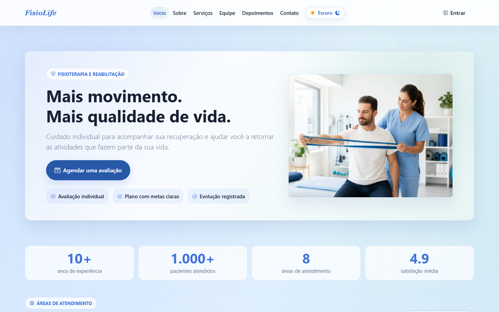

---

## Sumário

- [Sobre o projeto](#sobre-o-projeto)
- [Telas do sistema](#telas-do-sistema)
- [Funcionalidades por perfil](#funcionalidades-por-perfil)
- [Como o sistema funciona](#como-o-sistema-funciona)
- [Segurança e proteção de dados](#segurança-e-proteção-de-dados)
- [Qualidade e testes](#qualidade-e-testes)
- [Tecnologias](#tecnologias)
- [Código-fonte e licença](#código-fonte-e-licença)
- [Autor](#autor)

---

## Sobre o projeto

Em muitas clínicas pequenas, os horários, os dados dos pacientes e os pagamentos ficam espalhados entre agendas de papel, planilhas e mensagens. Isso causa **horários marcados duas vezes**, **evoluções clínicas perdidas** e **dificuldade para saber quanto a clínica recebeu**.

O **FisioLife** reúne essa rotina em um único sistema web:

- 📅 **O paciente** vê os horários livres e marca a própria consulta, sem precisar ligar para a clínica.
- 🩺 **O fisioterapeuta** acompanha a agenda do dia e registra a evolução de cada atendimento no prontuário.
- 🗂️ **A recepção** organiza a agenda de todos os profissionais, os pacientes, os pagamentos e o caixa.
- 📊 **O administrador** gerencia contas e permissões, consulta relatórios financeiros e de produtividade e faz o backup do banco.

---

## Telas do sistema

> As telas abaixo mostram dados **fictícios** de demonstração.

### Área pública

| Serviços | Login |
| :---: | :---: |
| 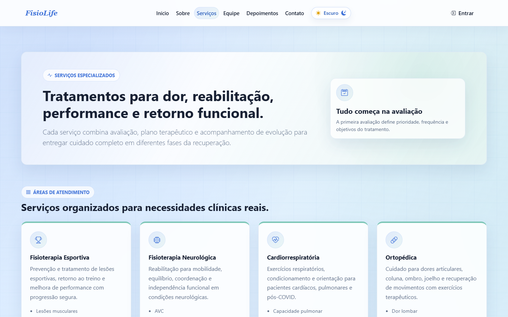 | 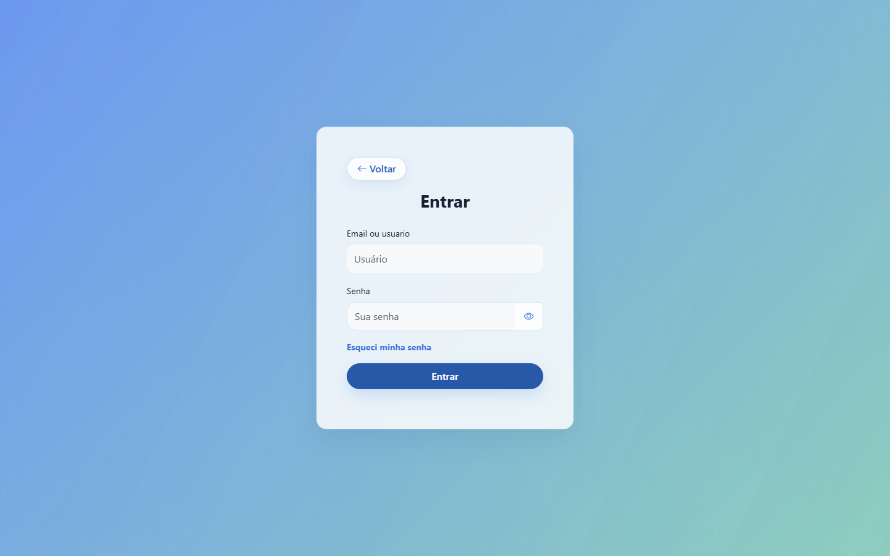 |

### Portais

| Paciente: agenda da semana e próximas consultas | Fisioterapeuta: turno e atendimentos do dia |
| :---: | :---: |
| 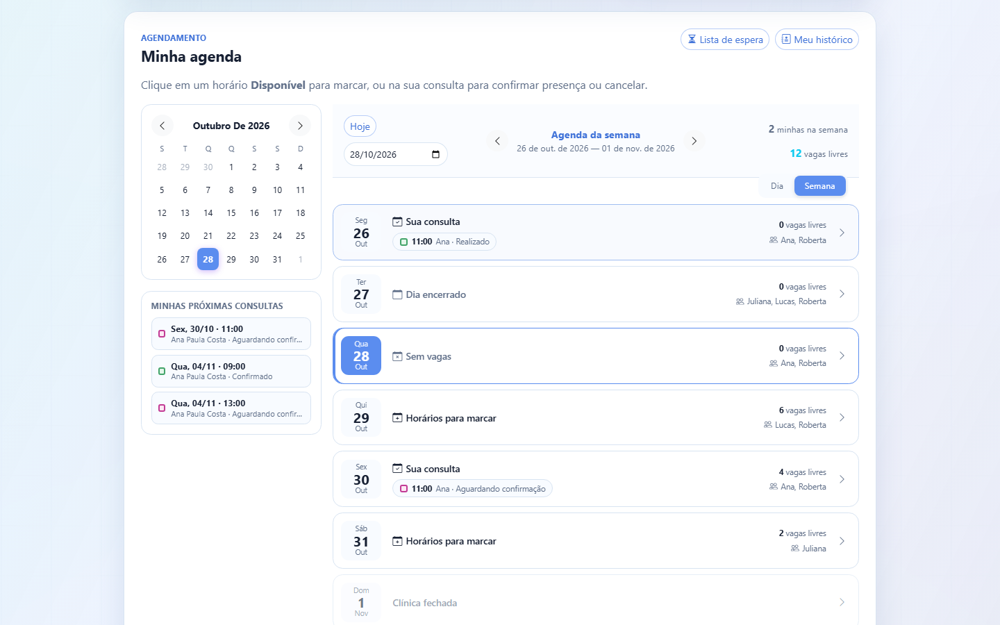 | 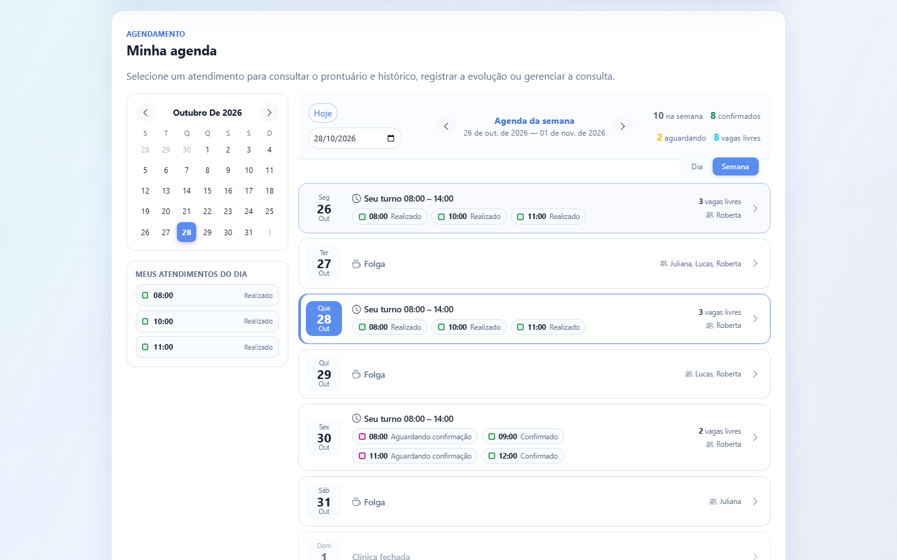 |

| Recepção: agenda de todos os profissionais | Prontuário e histórico do paciente |
| :---: | :---: |
| 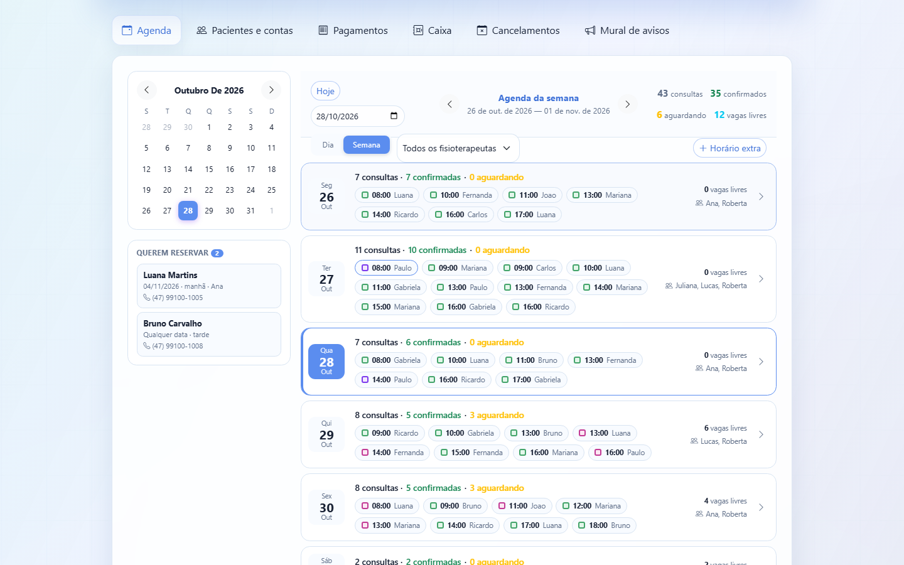 | 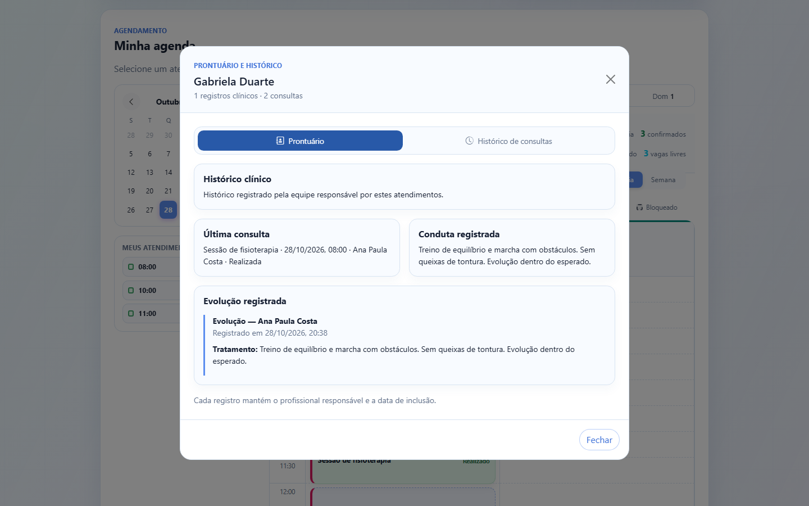 |

| Administrador: pagamentos e planos mensais | Administrador: relatório financeiro |
| :---: | :---: |
| 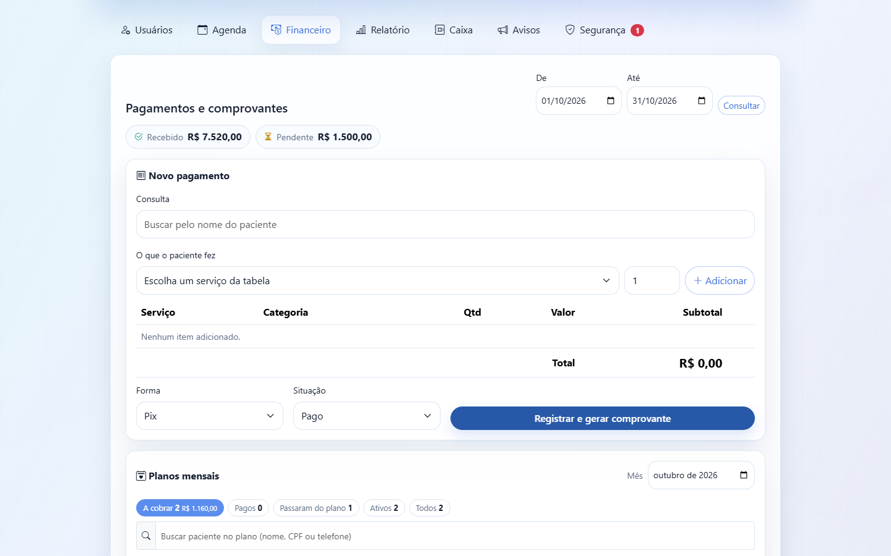 | 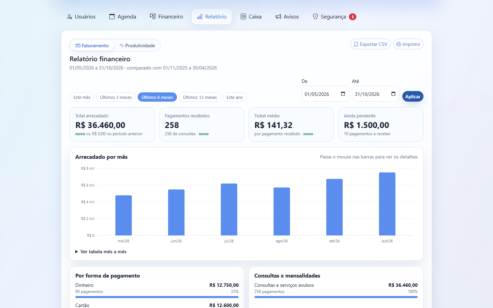 |

### Tema escuro e celular

| Tema escuro | Celular |
| :---: | :---: |
| 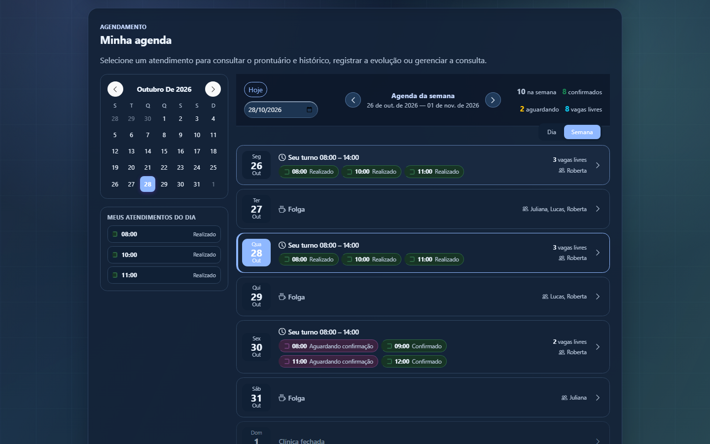 | 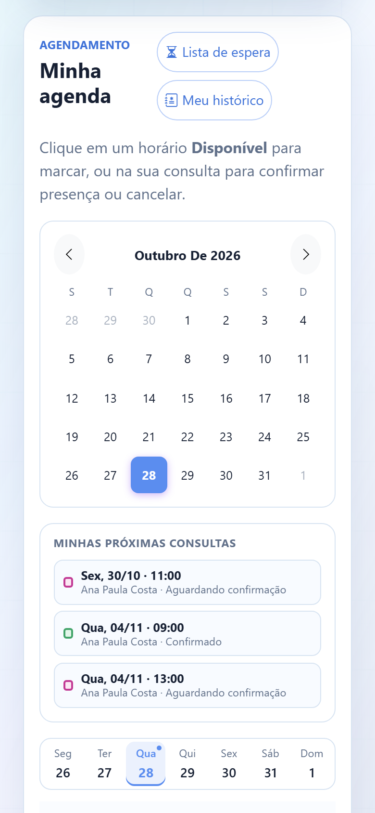 |

---

## Funcionalidades por perfil

<table>
<tr>
<td width="50%" valign="top">

### 🧑 Paciente
- Agenda por dia ou por semana, com os horários livres de cada fisioterapeuta
- Reserva com até 3 meses de antecedência
- Confirmação de presença e pedido de cancelamento
- Lista de espera quando não há vagas
- Histórico das consultas e do prontuário
- Acompanhamento do plano mensal (sessões usadas no mês)

</td>
<td width="50%" valign="top">

### 🩺 Fisioterapeuta
- Agenda do turno, com o status de cada atendimento
- Início e conclusão do atendimento
- Registro de evolução e de alta no prontuário
- Histórico clínico completo do paciente
- Registros permanentes: nada é sobrescrito

</td>
</tr>
<tr>
<td width="50%" valign="top">

### 🗂️ Recepção
- Agenda de todos os profissionais, com filtros
- Cadastro de pacientes e contas de acesso
- Horários extras e bloqueio de horários
- Pagamentos com itens da tabela de preços
- Caixa diário: abertura, suprimento, sangria e fechamento
- Comprovantes para imprimir ou salvar em PDF
- Pedidos de cancelamento e mural de avisos

</td>
<td width="50%" valign="top">

### 🛡️ Administrador
- Gestão de usuários, cargos e permissões
- Relatórios de faturamento e produtividade
- Exportação em CSV e versão para impressão
- Planos mensais e tabela de serviços
- Auditoria de acessos e alertas de segurança
- Backup completo do banco de dados

</td>
</tr>
</table>

---

## Como o sistema funciona

### Arquitetura

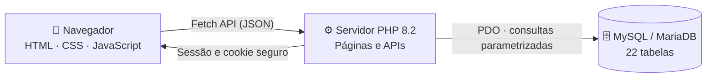

As páginas são geradas pelo servidor em PHP. As ações do dia a dia (marcar consulta, registrar evolução, lançar pagamento) passam por APIs em JSON, então a tela atualiza sem recarregar a página. Cada requisição confere quem é o usuário e o que o perfil dele pode fazer.

### Ciclo de uma consulta

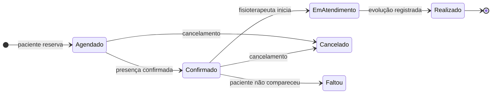

Concluir um atendimento grava a evolução no prontuário **na mesma transação** que muda o status. Assim, nunca existe consulta "realizada" sem o registro clínico correspondente.

### Banco de dados

O modelo relacional tem **22 tabelas**: pacientes, profissionais, horários, consultas, prontuários, pagamentos, caixa, planos, auditoria e outras.

<b>Ver o diagrama entidade-relacionamento (DER)</b>

 
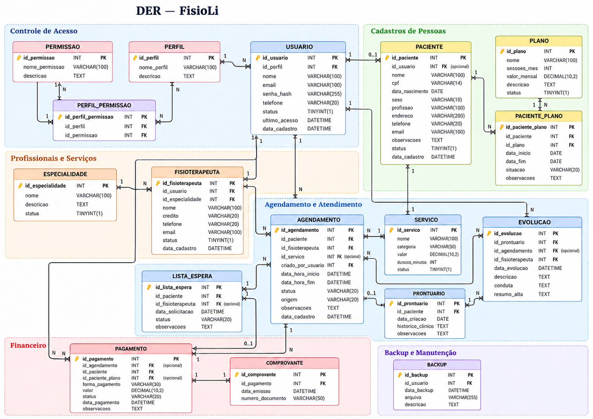

---

## Segurança e proteção de dados

O sistema guarda dados de saúde, que a LGPD classifica como **dados sensíveis**. Por isso a segurança faz parte do projeto desde o início:

| Mecanismo | Como funciona |
| --- | --- |
| 🔐 **Senhas criptografadas** | Senhas guardadas com hash bcrypt. A senha temporária precisa ser trocada no primeiro acesso. |
| 🚫 **Limite de tentativas** | O login é bloqueado temporariamente depois de várias tentativas erradas. |
| ⏱️ **Sessão com prazo** | A sessão encerra após 30 minutos sem uso. Trocar a senha ou desativar a conta derruba as sessões abertas. |
| 🛡️ **Proteção CSRF** | Toda ação que altera dados exige um token válido da sessão. |
| 💉 **Proteção contra SQL Injection** | Todas as consultas usam PDO com parâmetros separados do SQL. |
| 👥 **Acesso por perfil** | O fisioterapeuta vê apenas os próprios atendimentos, o paciente vê só os próprios dados e a recepção não acessa o prontuário. |
| 📝 **Auditoria** | Acessos e ações importantes ficam registrados para o administrador. |
| 🔑 **Recuperação de senha** | Código enviado por e-mail, válido por 15 minutos, com limite de tentativas. |

---

## Qualidade e testes

| Tipo | O que verifica |
| --- | --- |
| ✅ **52 testes de integração** | Login, permissões, CSRF, reservas, conflito de horários, prontuário, alta, caixa, pagamentos, recuperação de senha, sessões e backup |
| ✅ **Testes de validação** | Datas, horários e CPF |
| ✅ **Testes de navegador** (Playwright) | Calendários do paciente e do fisioterapeuta, uso pelo celular, teclado e tema escuro |

Os testes rodam em um banco separado e descartável. Os dados reais da clínica nunca são usados.

---

## Tecnologias

| Camada | Tecnologias |
| --- | --- |
| **Interface** | HTML5, CSS3 (Grid e Flexbox), JavaScript, Bootstrap 5.3, Bootstrap Icons |
| **Servidor** | PHP 8.2, sessões PHP, Fetch API e JSON |
| **Banco de dados** | MySQL / MariaDB 10.4 (InnoDB, chaves estrangeiras e transações) |
| **Ambiente** | XAMPP (Apache, MariaDB, phpMyAdmin) e Git |
| **Testes** | PHP CLI, Python e Playwright |

---

## Código-fonte e licença

Este repositório é uma **vitrine do projeto**: apresenta o sistema, as telas e o funcionamento. **O código-fonte é privado.**

© 2026 Thiago Soethe Paschoal. **Todos os direitos reservados.** É proibido copiar, modificar, distribuir ou usar comercialmente o sistema, as telas ou a documentação sem autorização por escrito do autor. Veja o arquivo [LICENSE](LICENSE).

Para avaliação acadêmica, demonstração ou interesse comercial, entre em contato pelo GitHub: [github.com/thiagosoethe](https://github.com/thiagosoethe).

---

## Autor

<table>
<tr>
<td>

**Thiago Soethe Paschoal** 
Análise e Desenvolvimento de Sistemas, UniSENAI Joinville/SC 
Projeto Individual, 2026 
[github.com/thiagosoethe](https://github.com/thiagosoethe)

</td>
</tr>
</table>
